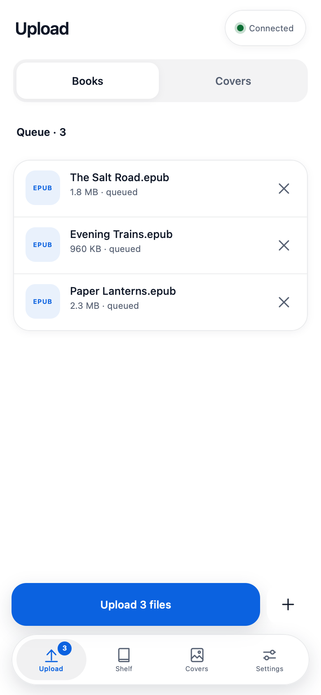
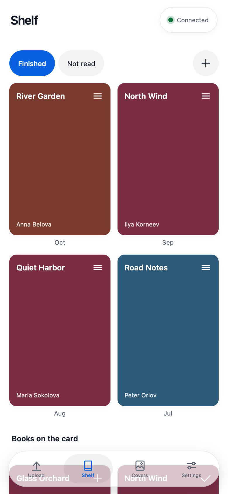
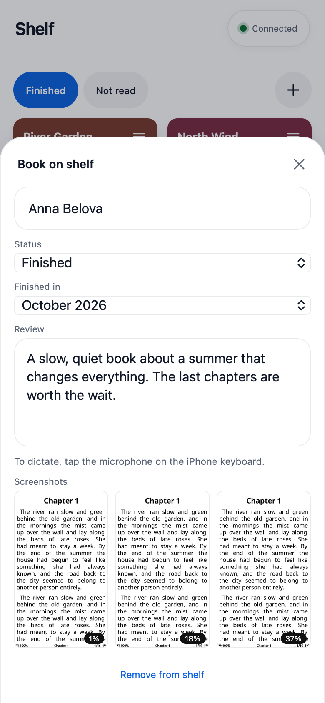
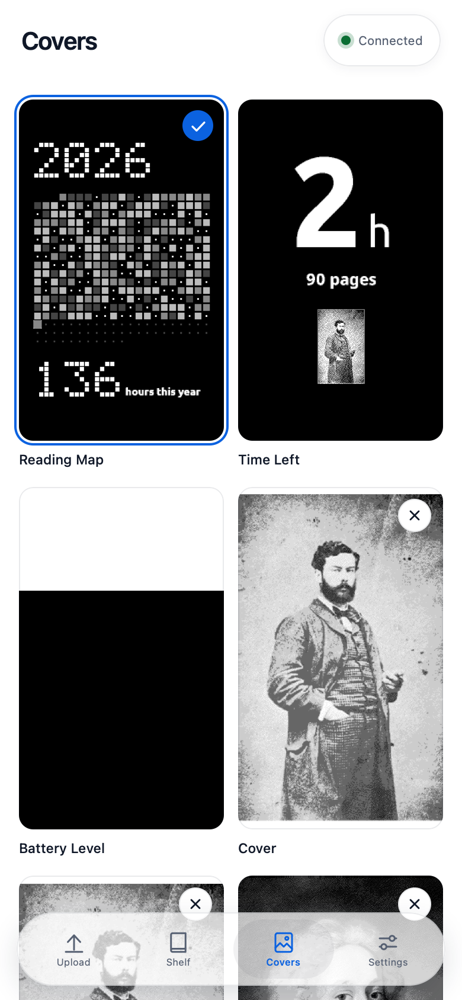
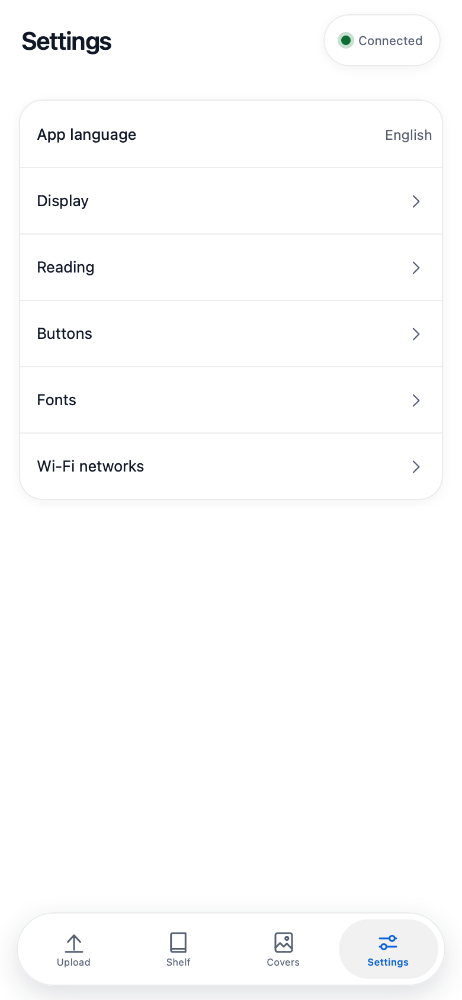
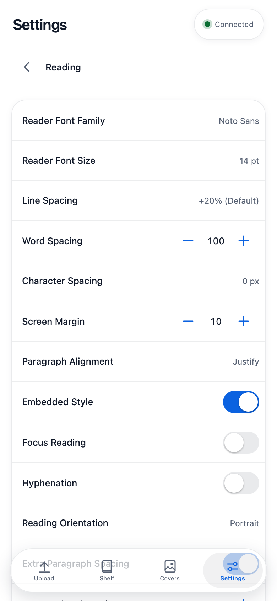

# Книги X4: загрузка книг с iPhone

## Screenshots

X4 Books is a web app for the Xteink X4 e-reader on CrossPoint firmware. From an iPhone you can upload books and covers, arrange the shelf, write reviews, choose the sleep screen and change the reader's settings.

| Upload | Shelf | Book |
| --- | --- | --- |
|  |  |  |

| Covers | Settings | Reading settings |
| --- | --- | --- |
|  |  |  |

Books, authors and reviews in these screenshots are invented. The sample portraits in the cover previews (`sd-card/book-uploader/covers.png`) come from Wikimedia Commons: Alfred Sisley, unknown photographer, public domain; Antoine Watteau, painting by Rosalba Carriera, public domain, photograph by Didier Descouens (Archaeodontosaurus), CC BY-SA 4.0.

Язык приложения по умолчанию английский. Русский включается в Settings → App language.

Веб-приложение, которое отправляет книги с iPhone на читалку Xteink X4. Прошивку менять не нужно: страница лежит на карте памяти и её отдаёт сама читалка.

## Установка (один раз)

Нужно положить на карту памяти папку `sd-card/book-uploader` из этого каталога, в самый корень карты. Должно получиться `/book-uploader/index.html`.

Чтобы добавить шрифты, положите в корень карты ещё и папку `sd-card/fonts`: должно получиться `/fonts/Literata/` и так далее. Шрифт выбирается на читалке или в Settings → Reading → Reader Font Family.

Способ 1, через компьютер: вставьте карту в Mac и скопируйте папку.

Способ 2, по Wi‑Fi: на читалке откройте «Передача файлов», в браузере на Mac зайдите на `http://crosspoint.local/files`, создайте папку `book-uploader` и загрузите в неё все файлы.

## Как открыть на iPhone

1. На читалке откройте **«Передача файлов»** и выберите **«Создать точку доступа»**.
2. На iPhone: Настройки → Wi‑Fi → сеть **CrossPoint-Reader**. Если появится окошко входа в сеть, закройте его и оставайтесь в этой сети, даже если iPhone предупредит, что интернета нет.
3. В Safari откройте адрес:

   `http://crosspoint.local/book-uploader/index.html`

   Если адрес не открывается, используйте `http://192.168.4.1/book-uploader/index.html`.
4. Чтобы был значок: кнопка «Поделиться» → «На экран „Домой“».

Если читалка и iPhone подключены к одной домашней сети, можно выбрать на читалке «Подключиться к сети». Адрес тот же, с `crosspoint.local`, или с IP-адресом, который показан на экране читалки.

## Что загружать

На вкладке «Загрузка» переключатель выбирает, что загружать: книги попадают в корень карты, обложки (JPG, PNG, BMP) — в папку `sleep`. Картинка автоматически обрезается под экран и переводится в серый BMP, а читалка переключается на свои картинки. Если их несколько, читалка выбирает случайную.

## Обложки

Вкладка «Обложки» показывает все виды экрана сна с настоящими превью: нажмите на вид, и он сразу включится на читалке. Превью лежат в файле `book-uploader/covers.png`, его тоже нужно копировать на карту.

Крестик на плитке убирает её. Reading Map, Time Left и Battery Level не убираются, как и вид, который сейчас включён. Убранные виды возвращает кнопка внизу списка. Ваши загруженные картинки показаны здесь же, крестик на них удаляет файл с карты насовсем.

## Что важно знать

- Значок открывается только тогда, когда на читалке открыта «Передача файлов». Иначе iPhone покажет свою ошибку «не удалось открыть страницу»: приложение хранится на читалке и без неё не запустится.
- Значок привязан к адресу, с которого его добавили. Значок с `192.168.4.1` работает только в режиме точки доступа.
- Пока идёт загрузка, не блокируйте экран и не сворачивайте приложение: iPhone оборвёт соединение. Незаконченный файл читалка удалит, очередь останется, загрузку можно продолжить.
- Форматы: EPUB, TXT, MD, XTC, XTCH и BMP.
- Если файл с таким именем уже есть, приложение спросит, заменить его или нет.

## Настройки читалки

Вкладка «Настройки» показывает то, что удобно менять с телефона: экран, чтение и строку внизу страницы, кнопки, шрифты и сети Wi‑Fi. Изменения сохраняются сразу. Названия настроек приходят с самой читалки и совпадают с её языком.

Всё остальное меняется на самой читалке: тема меню, синхронизация, OPDS-каталоги, редкие настройки кнопок, язык, раскладки клавиатуры, часы, очистка кэша чтения и обновление прошивки.

## Полка

Вкладка «Полка» настраивает вторую страницу читалки: как расставите книги здесь, так они и будут стоять там. Полки «Прочитано» и «Не прочитано» есть всегда, плюс сверху создаёт новую полку из книг на устройстве. Нажатие на название переименовывает полку, кнопка + на книге ставит её на текущую полку. Полка хранится на карте в файле `book-uploader/shelf.json`, при обновлении приложения его не удаляйте.

## Рецензии на книги

На вкладке «Полка» нажмите на книгу и напишите рецензию: она сохраняется сама, как и название, автор и статус. Чтобы наговорить её голосом, нажмите микрофон на клавиатуре iPhone. Рецензии хранятся на карте в папке `book-uploader/reviews`, поэтому при обновлении приложения не удаляйте эту папку.

## Скриншоты

Скриншоты, снятые на читалке во время чтения, появляются на вкладке «Полка» в окне книги. Они остаются на карте в папке `screenshots`, нажатие открывает скриншот целиком.

## Почему страница лежит на читалке

Читалка работает только по обычному http. Страницу с https-сайта Safari к ней не подпустит: это запрет смешанного содержимого. Обычная http-страница на чужом сервере не откроется в режиме точки доступа, потому что в этой сети нет интернета, а работать без сети без https такая страница не может. Страница с самой читалки обходит оба ограничения.
